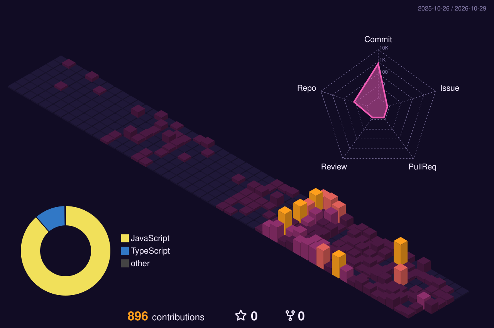

<!-- Animated art lives in ./assets — edit assets/build.mjs and run `node assets/build.mjs` to regenerate. -->

  

  

  

<table align="center">
  <tr>
    <td align="center" width="140"><b>Languages</b></td>
    <td></td>
  </tr>
  <tr>
    <td align="center"><b>Frontend</b></td>
    <td></td>
  </tr>
  <tr>
    <td align="center"><b>Backend</b></td>
    <td></td>
  </tr>
  <tr>
    <td align="center"><b>Ship &amp; Tools</b></td>
    <td></td>
  </tr>
  <tr>
    <td align="center"><b>Also</b></td>
    <td>
      
      
      
      
    </td>
  </tr>
</table>

 

  

<!-- Both images below are generated by .github/workflows/profile-art.yml from my real contribution graph -->

<picture>
  <source media="(prefers-color-scheme: dark)" srcset="https://raw.githubusercontent.com/Jai-Sainii/Jai-Sainii/output/snake-dark.svg" />
  <source media="(prefers-color-scheme: light)" srcset="https://raw.githubusercontent.com/Jai-Sainii/Jai-Sainii/output/snake-light.svg" />
  
</picture>

  

  

