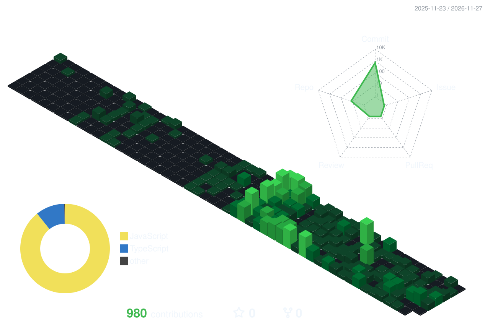

<!--
  Custom art lives in ./assets/dark and ./assets/light. Edit CONFIG in assets/build.mjs, then run `node assets/build.mjs`.
  <picture> sources use absolute raw URLs so they resolve on the profile page. If the username changes, update them here.
  Every block is an explicit 
 with no blank lines inside, so GitHub renders the HTML exactly as written.
-->

  <picture>
    <source media="(prefers-color-scheme: dark)" srcset="https://raw.githubusercontent.com/Jai-Sainiii/Jai-Sainiii/main/assets/dark/hero.svg" />
    <source media="(prefers-color-scheme: light)" srcset="https://raw.githubusercontent.com/Jai-Sainiii/Jai-Sainiii/main/assets/light/hero.svg" />
    
  </picture>

  <a href="mailto:jaisaini4a@gmail.com"><picture><source media="(prefers-color-scheme: dark)" srcset="https://raw.githubusercontent.com/Jai-Sainiii/Jai-Sainiii/main/assets/dark/btn-contact.svg" /><source media="(prefers-color-scheme: light)" srcset="https://raw.githubusercontent.com/Jai-Sainiii/Jai-Sainiii/main/assets/light/btn-contact.svg" /></picture></a>
  <a href="https://linkedin.com/in/jai-sainii"><picture><source media="(prefers-color-scheme: dark)" srcset="https://raw.githubusercontent.com/Jai-Sainiii/Jai-Sainiii/main/assets/dark/btn-linkedin.svg" /><source media="(prefers-color-scheme: light)" srcset="https://raw.githubusercontent.com/Jai-Sainiii/Jai-Sainiii/main/assets/light/btn-linkedin.svg" /></picture></a>
  <a href="https://github.com/Jai-Sainiii?tab=repositories"><picture><source media="(prefers-color-scheme: dark)" srcset="https://raw.githubusercontent.com/Jai-Sainiii/Jai-Sainiii/main/assets/dark/btn-repos.svg" /><source media="(prefers-color-scheme: light)" srcset="https://raw.githubusercontent.com/Jai-Sainiii/Jai-Sainiii/main/assets/light/btn-repos.svg" /></picture></a>

  <picture>
    <source media="(prefers-color-scheme: dark)" srcset="https://raw.githubusercontent.com/Jai-Sainiii/Jai-Sainiii/main/assets/dark/about.svg" />
    <source media="(prefers-color-scheme: light)" srcset="https://raw.githubusercontent.com/Jai-Sainiii/Jai-Sainiii/main/assets/light/about.svg" />
    
  </picture>

  <picture>
    <source media="(prefers-color-scheme: dark)" srcset="https://raw.githubusercontent.com/Jai-Sainiii/Jai-Sainiii/main/assets/dark/head-stack.svg" />
    <source media="(prefers-color-scheme: light)" srcset="https://raw.githubusercontent.com/Jai-Sainiii/Jai-Sainiii/main/assets/light/head-stack.svg" />
    
  </picture>

  <picture>
    <source media="(prefers-color-scheme: dark)" srcset="https://raw.githubusercontent.com/Jai-Sainiii/Jai-Sainiii/main/assets/dark/stack.svg" />
    <source media="(prefers-color-scheme: light)" srcset="https://raw.githubusercontent.com/Jai-Sainiii/Jai-Sainiii/main/assets/light/stack.svg" />
    
  </picture>

  <picture>
    <source media="(prefers-color-scheme: dark)" srcset="https://raw.githubusercontent.com/Jai-Sainiii/Jai-Sainiii/main/assets/dark/head-activity.svg" />
    <source media="(prefers-color-scheme: light)" srcset="https://raw.githubusercontent.com/Jai-Sainiii/Jai-Sainiii/main/assets/light/head-activity.svg" />
    
  </picture>

  <picture>
    <source media="(prefers-color-scheme: dark)" srcset="https://my-github-stats-smoky.vercel.app/api?username=Jai-Sainiii&show_icons=true&include_all_commits=true&count_private=true&rank_icon=github&card_width=495&border_radius=12&bg_color=0d1117&border_color=30363d&title_color=f0f6fc&text_color=9198a1&icon_color=3fb950&ring_color=3fb950" />
    <source media="(prefers-color-scheme: light)" srcset="https://my-github-stats-smoky.vercel.app/api?username=Jai-Sainiii&show_icons=true&include_all_commits=true&count_private=true&rank_icon=github&card_width=495&border_radius=12&bg_color=f6f8fa&border_color=d1d9e0&title_color=1f2328&text_color=59636e&icon_color=1a7f37&ring_color=1a7f37" />
    
  </picture>
  <picture>
    <source media="(prefers-color-scheme: dark)" srcset="https://streak-stats.demolab.com/?user=Jai-Sainiii&border_radius=12&background=0d1117&border=30363d&stroke=30363d&ring=3fb950&fire=3fb950&currStreakNum=f0f6fc&sideNums=f0f6fc&currStreakLabel=3fb950&sideLabels=9198a1&dates=656c76" />
    <source media="(prefers-color-scheme: light)" srcset="https://streak-stats.demolab.com/?user=Jai-Sainiii&border_radius=12&background=f6f8fa&border=d1d9e0&stroke=d1d9e0&ring=1a7f37&fire=1a7f37&currStreakNum=1f2328&sideNums=1f2328&currStreakLabel=1a7f37&sideLabels=59636e&dates=818b98" />
    
  </picture>
  <picture>
    <source media="(prefers-color-scheme: dark)" srcset="https://my-github-stats-smoky.vercel.app/api/top-langs/?username=Jai-Sainiii&layout=compact&langs_count=6&hide_title=true&card_width=846&border_radius=12&bg_color=0d1117&border_color=30363d&text_color=9198a1" />
    <source media="(prefers-color-scheme: light)" srcset="https://my-github-stats-smoky.vercel.app/api/top-langs/?username=Jai-Sainiii&layout=compact&langs_count=6&hide_title=true&card_width=846&border_radius=12&bg_color=f6f8fa&border_color=d1d9e0&text_color=59636e" />
    
  </picture>

  <picture>
    <source media="(prefers-color-scheme: dark)" srcset="https://raw.githubusercontent.com/Jai-Sainiii/Jai-Sainiii/main/assets/dark/head-contributions.svg" />
    <source media="(prefers-color-scheme: light)" srcset="https://raw.githubusercontent.com/Jai-Sainiii/Jai-Sainiii/main/assets/light/head-contributions.svg" />
    
  </picture>

<!-- Both graphics below are regenerated by .github/workflows/profile-art.yml from real contribution data -->

  <picture>
    <source media="(prefers-color-scheme: dark)" srcset="https://raw.githubusercontent.com/Jai-Sainiii/Jai-Sainiii/main/profile-3d-contrib/profile-dark.svg" />
    <source media="(prefers-color-scheme: light)" srcset="https://raw.githubusercontent.com/Jai-Sainiii/Jai-Sainiii/main/profile-3d-contrib/profile-light.svg" />
    
  </picture>

  <picture>
    <source media="(prefers-color-scheme: dark)" srcset="https://raw.githubusercontent.com/Jai-Sainiii/Jai-Sainiii/output/snake-dark.svg" />
    <source media="(prefers-color-scheme: light)" srcset="https://raw.githubusercontent.com/Jai-Sainiii/Jai-Sainiii/output/snake-light.svg" />
    
  </picture>

  <a href="mailto:jaisaini4a@gmail.com"><picture><source media="(prefers-color-scheme: dark)" srcset="https://raw.githubusercontent.com/Jai-Sainiii/Jai-Sainiii/main/assets/dark/footer.svg" /><source media="(prefers-color-scheme: light)" srcset="https://raw.githubusercontent.com/Jai-Sainiii/Jai-Sainiii/main/assets/light/footer.svg" /></picture></a>

  

